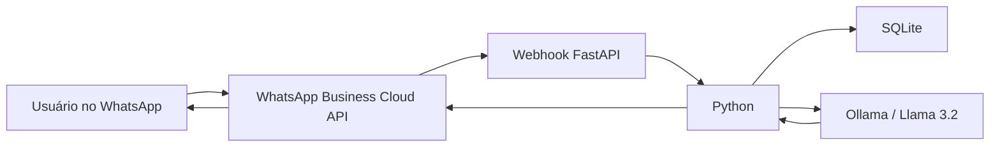

# 🤖 WhatsApp IA — Assistente Inteligente com Python

Chatbot inteligente integrado ao WhatsApp utilizando Python, FastAPI, WhatsApp Business Cloud API e inteligência artificial local com Ollama.

O projeto recebe mensagens reais do WhatsApp, processa o conteúdo com IA e responde automaticamente ao usuário, mantendo o histórico e o contexto da conversa.

> Projeto desenvolvido para estudo, prática e portfólio profissional.

---

## 🚀 Funcionalidades

- Recebimento de mensagens reais do WhatsApp
- Integração com WhatsApp Business Cloud API
- Webhook desenvolvido com FastAPI
- Respostas automáticas utilizando Inteligência Artificial
- IA executada localmente através do Ollama
- Modelo Llama 3.2
- Histórico das conversas
- Memória de contexto por usuário
- Persistência de memória utilizando SQLite
- Tratamento de mensagens duplicadas
- Processamento em background
- Integração pública do ambiente local através do ngrok
- Proteção de credenciais através de variáveis de ambiente
- Respostas limitadas às informações cadastradas da empresa

---

## 🧠 Como funciona

O usuário envia uma mensagem pelo WhatsApp.

A Meta envia essa mensagem para o webhook da aplicação.

O FastAPI recebe a requisição e identifica o usuário e o conteúdo da mensagem.

A aplicação consulta o histórico daquele usuário e envia a conversa para o modelo de IA executado pelo Ollama.

A resposta é gerada e enviada novamente para o usuário através da API do WhatsApp.



---

## 🛠️ Tecnologias utilizadas

- Python
- FastAPI
- Uvicorn
- Requests
- Pydantic
- SQLite
- Ollama
- Llama 3.2
- WhatsApp Business Cloud API
- Meta Graph API
- Webhooks
- ngrok
- dotenv

---

## 📁 Estrutura do projeto

```text
whatsapp_ia/
│
├── config.py
├── historico.py
├── ia.py
├── iniciar.ps1
├── main.py
├── memoria.py
├── requirements.txt
├── whatsapp.py
├── .env.example
├── .gitignore
└── README.md
```

### Arquivos principais

**main.py**  
Responsável pela API FastAPI, webhook e fluxo principal da aplicação.

**ia.py**  
Integração da aplicação com o modelo de inteligência artificial através do Ollama.

**whatsapp.py**  
Responsável pelo envio das mensagens utilizando a WhatsApp Business Cloud API.

**memoria.py**  
Gerencia a memória das conversas utilizando SQLite.

**historico.py**  
Registra o histórico das conversas.

**config.py**  
Contém as informações utilizadas pelo assistente para responder aos clientes.

---

## 🔄 Fluxo de uma mensagem

```text
Cliente
   ↓
WhatsApp
   ↓
Meta Cloud API
   ↓
Webhook
   ↓
FastAPI
   ↓
Python
   ↓
Histórico / SQLite
   ↓
Ollama / Llama 3.2
   ↓
Python
   ↓
Meta Cloud API
   ↓
WhatsApp
   ↓
Cliente
```

---

## 💬 Exemplo

### Cliente

```text
Qual horário de atendimento?
```

### Assistente

```text
O horário de atendimento é de segunda a sexta-feira, das 8h às 18h.
```

### Continuação da conversa

```text
Cliente: E no sábado?
```

O assistente utiliza o histórico da conversa para entender que a pergunta continua relacionada ao horário de atendimento.

---

## 🧩 Memória de conversa

Cada usuário possui seu próprio histórico.

As mensagens são armazenadas em um banco SQLite e utilizadas como contexto nas próximas interações.

Isso permite conversas como:

```text
Cliente:
Vocês fazem entregas?

Assistente:
Sim, realizamos entregas em Fortaleza e região metropolitana.

Cliente:
Em qual região?

Assistente:
Fortaleza e região metropolitana.
```

Mesmo após reiniciar a aplicação, o histórico pode continuar disponível através do SQLite.

---

## 🔐 Segurança

As credenciais não são armazenadas diretamente no código.

São utilizadas variáveis de ambiente através de um arquivo `.env`.

O `.env` está incluído no `.gitignore` e não deve ser enviado para o GitHub.

---

## ⚙️ Configuração

Clone o projeto:

```bash
git clone URL_DO_REPOSITORIO
```

Entre na pasta:

```bash
cd whatsapp_ia
```

Crie o ambiente virtual:

```bash
python -m venv .venv
```

Ative o ambiente no Windows:

```powershell
.\.venv\Scripts\Activate.ps1
```

Instale as dependências:

```bash
pip install -r requirements.txt
```

---

## 🤖 Ollama

O projeto utiliza uma IA executada localmente através do Ollama.

Modelo utilizado:

```bash
ollama pull llama3.2:3b
```

Para testar:

```bash
ollama run llama3.2:3b
```

---

## 🌐 Executando a API

Execute:

```bash
python -m uvicorn main:app --reload
```

A API ficará disponível em:

```text
http://127.0.0.1:8000
```

Documentação automática:

```text
http://127.0.0.1:8000/docs
```

---

## 🌍 Webhook

Durante o desenvolvimento foi utilizado o ngrok para disponibilizar o servidor local na internet.

```bash
ngrok http 8000
```

O endereço HTTPS gerado é utilizado como callback do webhook da Meta.

Exemplo:

```text
https://seu-endereco.ngrok-free.dev/webhook
```

---

## 🔑 Variáveis de ambiente

Crie um arquivo `.env` baseado no `.env.example`.

Exemplo:

```env
VERIFY_TOKEN=seu_token_de_verificacao
SYSTEM_USER_TOKEN=seu_token_da_meta
WHATSAPP_PHONE_NUMBER_ID=seu_phone_number_id
GRAPH_API_VERSION=v26.0
```

Nunca publique tokens reais no GitHub.

---

## 📌 Status do projeto

### Implementado

- Chatbot em Python
- FastAPI
- Integração com IA
- WhatsApp Business Cloud API
- Webhook
- Recebimento de mensagens reais
- Respostas automáticas
- Memória de conversa
- SQLite
- Controle de mensagens duplicadas
- Processamento em background

### Próximas etapas

- Hospedagem 24 horas
- Utilização de número WhatsApp Business próprio
- Painel administrativo
- Cadastro de informações pelo painel
- Transferência para atendimento humano
- Logs estruturados
- Suporte a áudio e imagens
- Separação da camada de serviços
- Testes automatizados

---

## 🎯 Objetivo do projeto

Este projeto foi desenvolvido como parte dos meus estudos e prática em desenvolvimento de software, com foco em:

- Python
- APIs REST
- Integração entre sistemas
- Inteligência Artificial
- Webhooks
- Banco de dados
- Automação
- Desenvolvimento Back-end

A proposta é aplicar conceitos de desenvolvimento em um cenário real de atendimento automatizado através do WhatsApp.

---

## 👨‍💻 Autor

**Antônio Novais**

Desenvolvedor e Analista de Sistemas

Projeto desenvolvido para estudo e portfólio profissional.